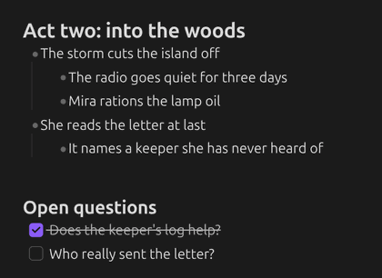
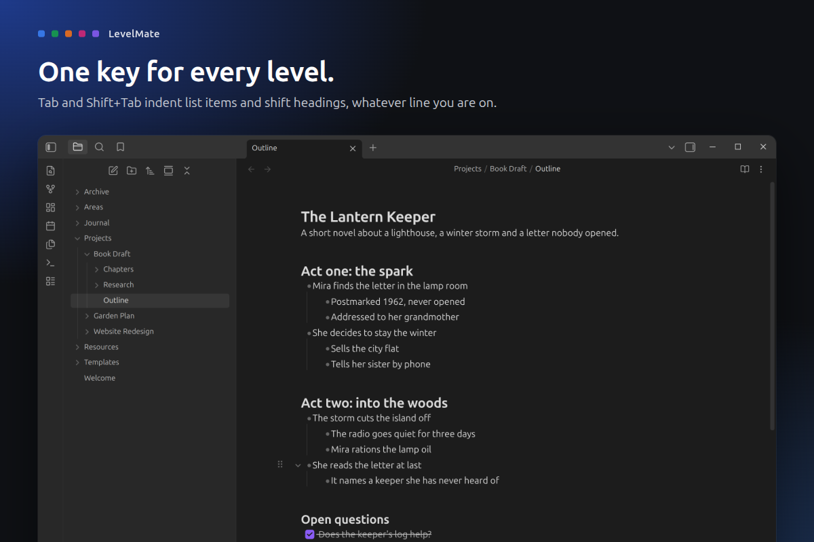
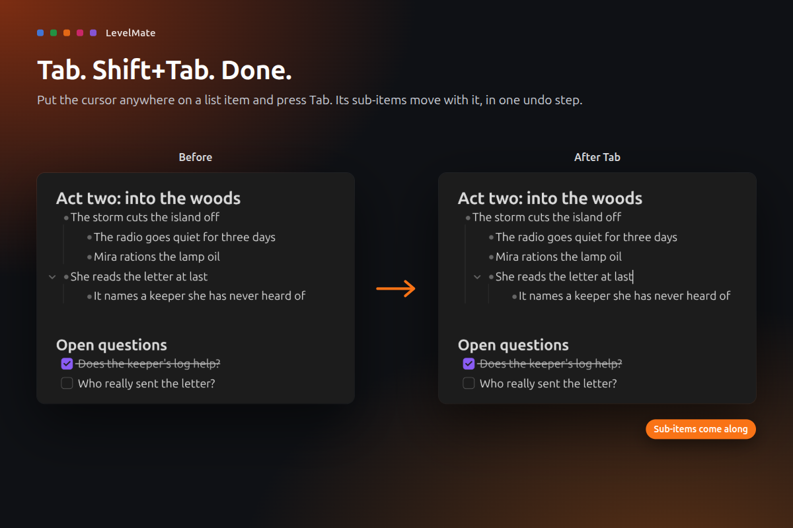
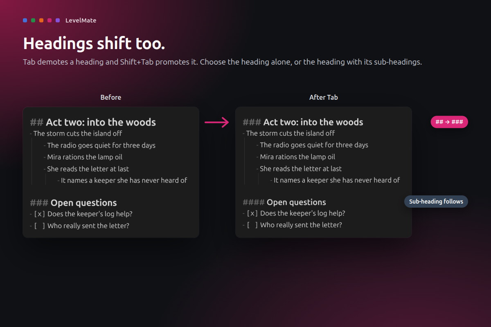
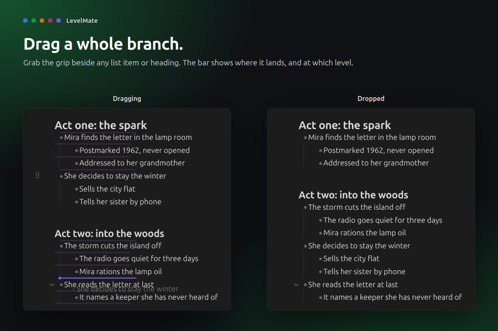
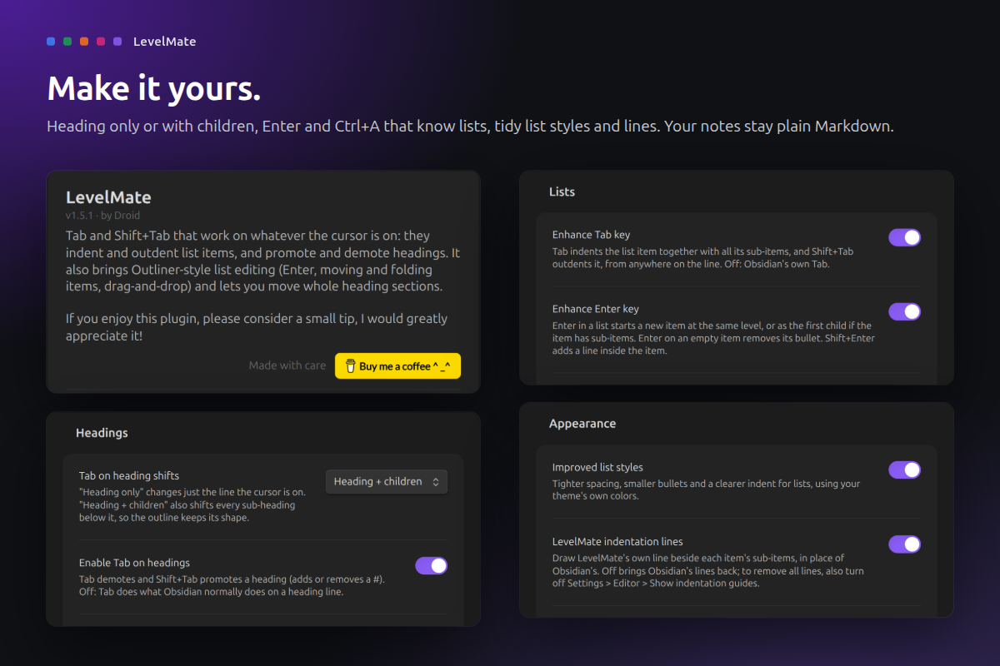

# LevelMate

**One key for every level. Lists and headings alike.**

Obsidian's Tab key knows lists but not headings, so restructuring a note means juggling two plugins that fight over the same key. LevelMate gives Tab and Shift+Tab one job: move the line you are on up or down a level, whether it is a list item or a heading. Press Tab, done.

## What it does

- **Tab for lists.** Tab indents a list item and Shift+Tab outdents it, from anywhere on the line. Its sub-items come along.
- **Tab for headings.** Tab turns `##` into `###` and Shift+Tab goes back. Shift the heading alone, or the heading with its sub-headings.
- **Outliner-style editing.** Enter that knows lists, a cursor that skips the bullet, step-by-step Ctrl+A, and commands to move items (one step, or straight to the top or bottom of the list) and fold them, on the keys you choose.
- **Whole sections move.** Move up or down on a heading swaps its whole section with the one next to it.
- **Drag and drop.** Grab the grip beside a list item or heading and drop the whole branch or section somewhere else. The bar shows the level it lands on.
- **Tidy lists.** Optional list styles and indentation lines that fold an item when you click them.
- **One undo step.** Every action, however many lines it touches, comes back with a single Ctrl+Z.

## How to use

1. Install LevelMate from **Settings > Community plugins** and enable it.
2. Put the cursor on a list item or a heading and press **Tab** or **Shift+Tab**.
3. To shift sub-headings too, open **Settings > LevelMate** and set **Tab on heading shifts** to *Heading + children*.
4. To move and fold items from the keyboard, open **Settings > Hotkeys**, search for "LevelMate" and give Move up, Move down, Move to top of list, Move to bottom of list, Fold and Unfold the keys you like (Outliner users: Ctrl+Shift+Up/Down and Ctrl+Up/Down).

If you use Outliner or Heading Shifter, turn them off. They claim the same keys.

## Privacy and safety

- **Your notes stay plain Markdown.** LevelMate only changes the lines you act on, in the note you are editing.
- **No network, no telemetry.** It also has no runtime dependencies.
- **Safe zones.** Code blocks, frontmatter, math blocks and tables are never treated as lists or headings.
- **Desktop only.** Needs Obsidian 1.13 or later.
- **Signed releases.** Every release is built by GitHub Actions from this repository and carries a [build provenance attestation](https://docs.github.com/en/actions/security-for-github-actions/using-artifact-attestations).

## Support

If LevelMate makes your outlines a little easier, you can [buy me a coffee](https://buymeacoffee.com/droidstreamer). Thank you!

## Develop

`npm ci`, `npm test`, `npm run lint`, `npm run build` (installs into `../test-vault`), `npm run obsidian:check` (live checks in a real Obsidian), `npm run showcase` (store screenshots), `npm run ship`.

MIT licensed. Made by Droid.
